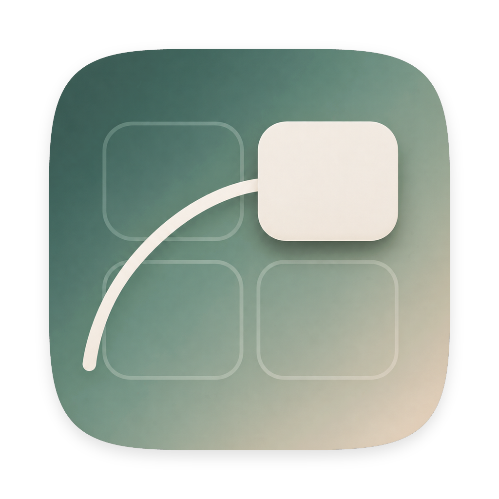
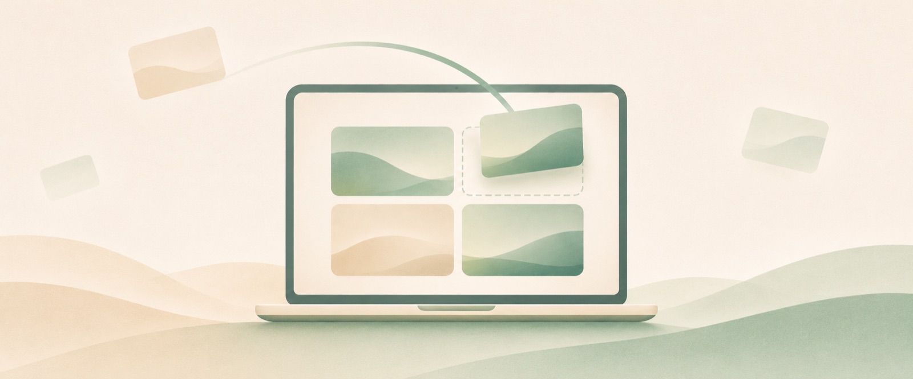
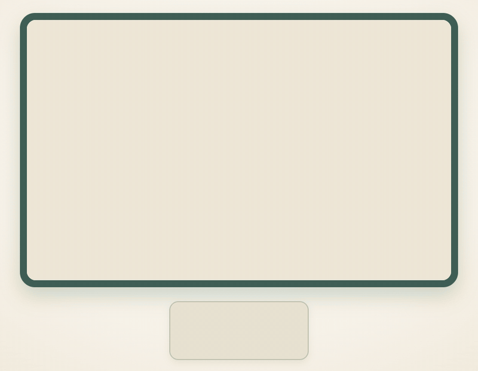
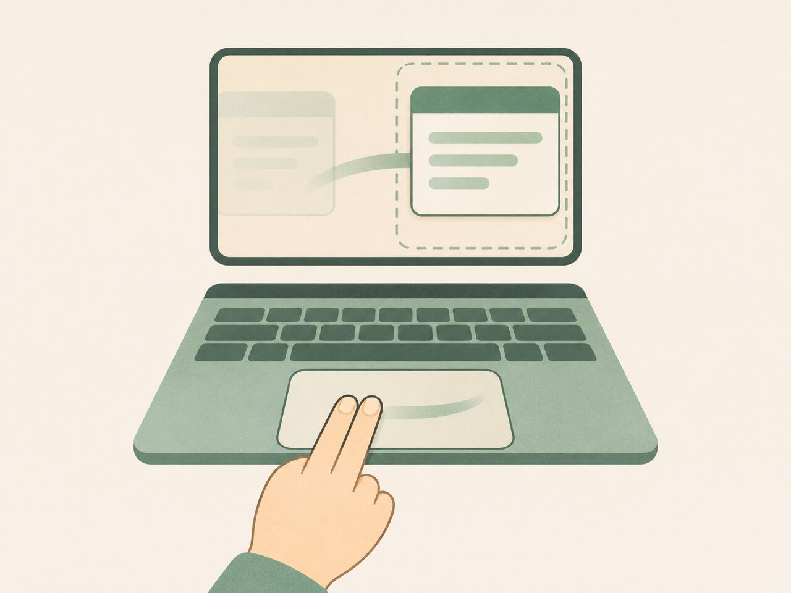
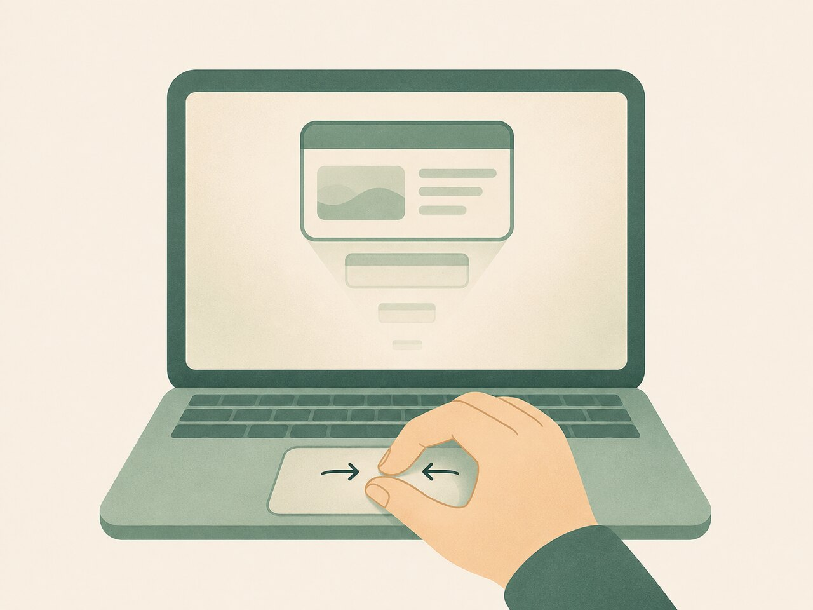
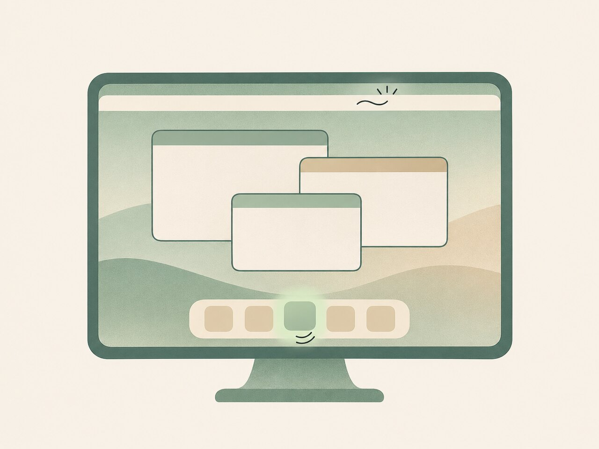
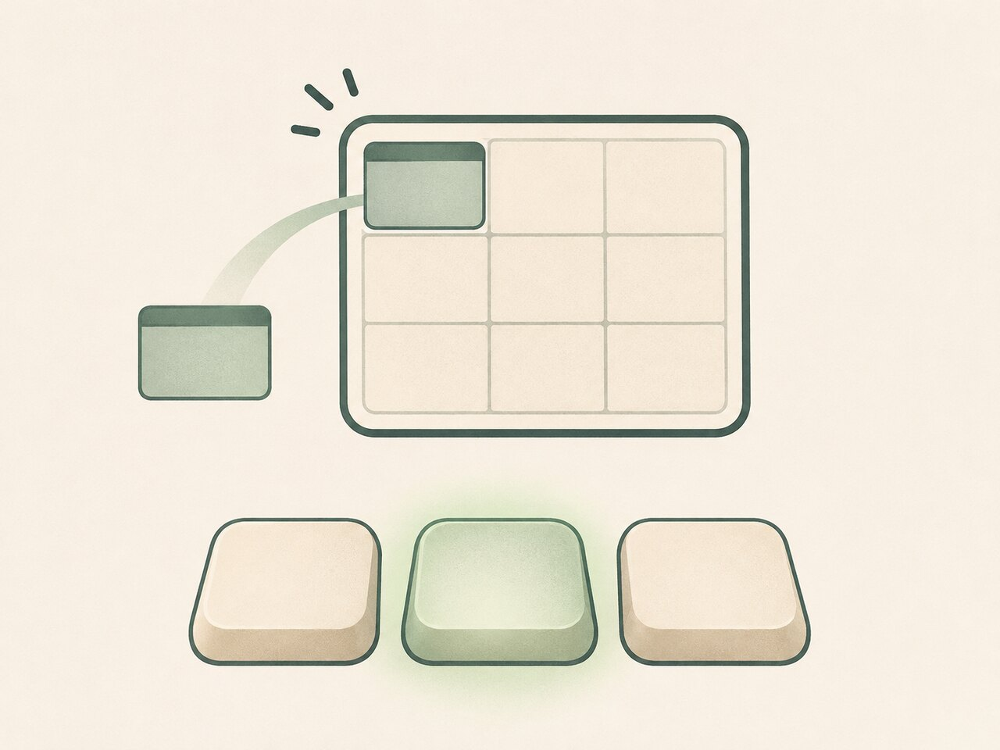
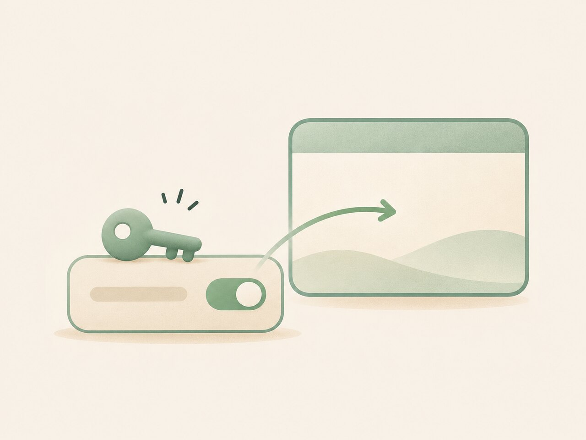

<p align="center">
  
</p>

<h1 align="center">Sweep</h1>

<p align="center">
  <b>Tidy your Mac with two fingers.</b><br>
  Swipe, pinch or tap on a window's titlebar to snap, move, minimize and close it.<br>
  No dragging. No tiny corners. No shortcuts to learn.
</p>

<p align="center">
  <a href="https://github.com/Nikohtr/sweep/releases/latest"></a>
</p>

<p align="center">
  <a href="https://github.com/Nikohtr/sweep/releases/latest"></a>
  
  
  <a href="LICENSE"></a>
  
</p>



## From clutter to calm

You already use two fingers to scroll. With Sweep, the same two fingers put every window where you want it.
Put them on a titlebar and swipe right: the window fills the right half. Swipe up: it fills the screen.
Pinch: it closes. It feels like the trackpad always could do this.

<p align="center">
  
</p>

## What you can do

<table>
  <tr>
    <td width="50%" valign="top">
      
      <h3>Snap with a swipe</h3>
      Swipe left or right for a half, up for the full screen, across and then up or down for a quarter.
      A soft outline shows where the window will go before you lift your fingers.
    </td>
    <td width="50%" valign="top">
      
      <h3>Pinch to close</h3>
      Pinch in to close a window. Pinch out for fullscreen. Swipe down to minimize.
      Double tap to unsnap a window and center it.
    </td>
  </tr>
  <tr>
    <td width="50%" valign="top">
      
      <h3>Dock and menu bar too</h3>
      Swipe on a Dock icon to minimize or bring back all of that app's windows.
      Swipe on the empty menu bar to switch apps or bring back every window at once.
    </td>
    <td width="50%" valign="top">
      
      <h3>Hold a key for more</h3>
      Hold a key while you swipe to get thirds, sixths or ninths, to send a window to your other display,
      or to use the whole window instead of only the titlebar.
    </td>
  </tr>
</table>

### And the small things that make it feel right

- **Tabs.** Pinch in to close a tab, pinch out for a new one, tap and hold to pull it into its own window.
  Works in Safari, Chrome, Arc, Xcode, VS Code, Finder, Terminal and other apps with standard Mac tabs.
- **Mission Control.** Pinch, swipe or snap windows right from Mission Control and App Exposé.
- **Undo.** Moved the wrong window? **Undo Window Move** puts it back. You can give it a key too.
- **Keyboard snapping.** Prefer keys some days? Turn on snapping with the Anywhere key and the arrow keys (or WASD).
- **Neighbors move together.** Resize one snapped window and the one next to it follows.
- **Haptic feedback.** A gentle tick on the trackpad when a gesture lands.
- **Pause in any app.** Turn gestures off for one app from the menu bar.
- **Every gesture is optional.** Turn off what you don't use in Settings › Gestures.
- **Bring your setup along.** Export your settings to a file and import them on your next Mac.

## Get started in a minute

1. **Download** `Sweep-<version>.zip` from [Releases](https://github.com/Nikohtr/sweep/releases/latest) and open it.
2. **Open `Sweep.app`** and click **Move to Applications**.
3. **Allow the first start.** Sweep is not notarized, so macOS blocks it once. Go to
   System Settings › Privacy & Security, click **Open Anyway** next to the message about Sweep, then open Sweep again.
4. **Allow Accessibility.** The Welcome window asks for it. Click **Allow…**, then turn on **Sweep** in
   Privacy & Security › Accessibility.

That's it. The Welcome window shows you each gesture, and Sweep lives quietly in your menu bar from then on.
Updates install from inside the app (Settings › About › Check for Updates…) without the warning.

## Private by design



Sweep needs Accessibility permission to find the window under your fingers and to move, resize, minimize
or close it. That is all it uses it for.

- It does not read what is inside your windows.
- It sends nothing over the network except the update check.
- It is free and open source, so anyone can check.

<br clear="right">

## Gesture cheat sheet

Make each gesture with two fingers. Most of them happen when you lift your fingers. Press Esc to cancel.

**On a titlebar (or empty toolbar space)**

| Gesture | What happens |
|---------|--------------|
| Swipe left / right | Snap to the left / right half |
| Swipe up | Fill the screen |
| Swipe up or down twice | Snap to the top / bottom half |
| Swipe across, then up or down | Snap to a quarter |
| Swipe down | Minimize |
| Pinch in | Close |
| Pinch out | Fullscreen on / off |
| Double tap | Unsnap and center |

**On a Dock icon**

| Gesture | What happens |
|---------|--------------|
| Double tap | Hide the app |
| Swipe down / up | Minimize / bring back its windows |
| Swipe left / right | Go through its windows |
| Tap and hold | Bring it to the front |
| Pinch in | Quit the app (off at first) |

**On the empty menu bar**

| Gesture | What happens |
|---------|--------------|
| Double tap | Unsnap all windows |
| Swipe up | Bring back all windows |
| Swipe left / right | Switch apps |
| Swipe down | Minimize all windows (off at first) |

**Hold a key while you swipe**

| Key | Default | What it gives you |
|-----|---------|-------------------|
| Extend | ⇧ | Thirds and sixths |
| Fine | ⌃⇧ | Ninths |
| Display | ⌥ | Move the window to another display |
| Anywhere | ⌘ | Gestures anywhere on a window, not only the titlebar |
| Action | ⌃ | Swipe down closes, double tap hides the app, move a window to another Space |

Change the keys in Settings › Keys.

## Questions

<details>
<summary><b>Does Sweep cost anything?</b></summary>

No. Sweep is free software under the GPL-3.0 license. No account, no ads.
</details>

<details>
<summary><b>Which Macs does it run on?</b></summary>

Any Mac with macOS 14 or later. It is one universal app for Apple silicon and Intel.
It is tested on Apple silicon only; **Intel is untested**. If you try it on Intel, tell us how it goes.
</details>

<details>
<summary><b>Why does macOS warn me the first time?</b></summary>

Sweep is not notarized by Apple, so macOS asks you to confirm the first start (step 3 above).
Updates from inside the app do not show the warning again.
</details>

<details>
<summary><b>How do I go back to the default settings?</b></summary>

Settings › About › **Restore All Settings…**
</details>

<details>
<summary><b>How do I uninstall Sweep?</b></summary>

Settings › About › **Uninstall Sweep…** turns off Open at login, deletes Sweep's settings, removes its
Accessibility permission and moves the app to the Trash.

By hand: quit Sweep, move `Sweep.app` to the Trash, then remove Sweep from System Settings › Privacy & Security ›
Accessibility (select it, click −) and from General › Login Items. To delete the settings too:
`defaults delete io.github.nikohtr.sweep`.
</details>

<details>
<summary><b>Something does not work. What do I do?</b></summary>

1. Settings › About › **Copy Debug Info…** shows a short report (version, macOS, input devices, settings; no window
   titles, no file paths, no names). Read it, then click Copy.
2. Settings › About › **Report a Problem…** opens [GitHub Issues](https://github.com/Nikohtr/sweep/issues).
   Say what you did, what you expected and what happened, and paste the report.
</details>

## Build from source

Needs Xcode 16 or later (Swift 6).

```sh
swift build          # debug build
swift test           # unit tests (no trackpad needed)
scripts/bundle.sh    # build/Sweep.app: universal (arm64 + x86_64), signed
```

`scripts/bundle.sh` signs with a "Sweep Self-Signed" certificate when your keychain has one, and ad hoc otherwise.
With an ad-hoc build, turn Sweep off and on again in Accessibility after each new build.

`Sources/SweepCore` has the gesture, layout and settings rules (no AppKit, fully tested);
`Sources/Sweep` is the menu bar app.

## License

Sweep is free software under the GNU General Public License, version 3 (GPL-3.0).
See [LICENSE](LICENSE).

Sweep uses [Sparkle](https://sparkle-project.org) for updates. Sparkle is under the MIT license.
Its notice ships in the app as `Sweep.app/Contents/Resources/Sparkle-LICENSE.txt`.
Both license texts open from Settings › About › Licenses.
