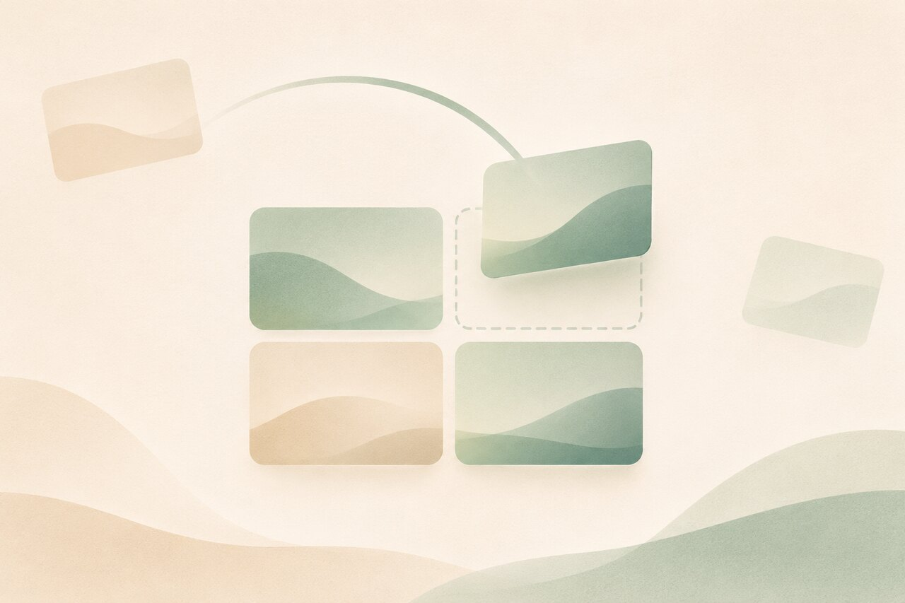

# Sweep



Sweep is a menu bar app for macOS. Put two fingers on a window's titlebar and swipe, pinch or tap
to snap, move, minimize and close windows. Gestures also work on Dock icons and on the empty menu bar.

- **Requires** macOS 14 or later.
- **Macs:** one universal app for Apple silicon and Intel. It is tested on Apple silicon only;
  **Intel is untested**.
- **Free software** under the GPL-3.0 license.

## Install

1. Download `Sweep-<version>.zip` from [Releases](https://github.com/Nikohtr/sweep/releases/latest) and open it.
2. Open `Sweep.app`. Sweep offers to move itself to the Applications folder: click **Move to Applications**.
3. Sweep is not notarized, so macOS blocks the first start. Go to System Settings › Privacy & Security
   and click **Open Anyway** next to the message about Sweep. Then open Sweep again.

Updates install from inside the app (Settings › About › Check for Updates…) and do not show this warning again.

## Allow Accessibility

Sweep reads which window is under your fingers and moves it with the Accessibility API. It needs your permission:

1. On the first start, the Welcome window asks for it. Click **Allow…**; macOS opens System Settings.
2. In Privacy & Security › Accessibility, turn on **Sweep**.

Sweep uses the permission only to find the window under your fingers and to move, resize, minimize or close it.
It does not read window contents and sends nothing over the network except the update check.

## Gestures

Make each gesture with two fingers. Most of them happen when you lift your fingers. Esc cancels a gesture.

**On a titlebar (or empty toolbar space)**

| Gesture | Result |
|---------|--------|
| Swipe left / right | Snap to the left / right half |
| Swipe up | Fill the screen |
| Swipe up or down twice | Snap to the top / bottom half |
| Swipe across, then up or down | Snap to a quarter |
| Swipe down | Minimize |
| Pinch in | Close |
| Pinch out | Fullscreen on / off |
| Double tap | Unsnap and center |

**On a Dock icon:** double tap hides the app, swipe down or up minimizes or brings back its windows, swipe left or
right goes through its windows, tap and hold brings it forward. Pinch in quits the app (off at first).

**On the empty menu bar:** double tap unsnaps all windows, swipe up brings back all windows, swipe left or right
switches apps. Swipe down minimizes all windows (off at first).

**Hold a key for more.** Defaults: Action ⌃, Display ⌥, Extend ⇧, Fine ⌃⇧, Anywhere ⌘.
Extend gives thirds and sixths, Fine gives ninths, Display moves windows to other displays,
Anywhere makes gestures work anywhere on a window. Change the keys in Settings › Keys.

Every gesture can be turned off in Settings › Gestures. Settings › Keys also has keyboard snapping and an
optional key to undo the last window move (the menu has **Undo Window Move** too).

## Settings

- **Export Settings… / Import Settings…** (Settings › General) save all settings, paused apps included, to a file.
- **Pause Sweep in This App** (Sweep menu) turns gestures off in one app.
- **Restore All Settings…** (Settings › About) goes back to the defaults.

## Uninstall

Settings › About › **Uninstall Sweep…** turns off Open at login, deletes Sweep's settings, removes its
Accessibility permission and moves the app to the Trash.

By hand: quit Sweep, move `Sweep.app` to the Trash, then remove Sweep from System Settings › Privacy & Security ›
Accessibility (select it, click −) and from General › Login Items. To delete the settings too:
`defaults delete io.github.nikohtr.sweep`.

## Report a problem

1. Settings › About › **Copy Debug Info…** shows a short report (version, macOS, input devices, settings; no window
   titles, no file paths, no names). Read it, then click Copy.
2. Settings › About › **Report a Problem…** opens [GitHub Issues](https://github.com/Nikohtr/sweep/issues).
   Say what you did, what you expected and what happened, and paste the report.

## Build from source

Needs Xcode 16 or later (Swift 6).

```sh
swift build          # debug build
swift test           # unit tests (no trackpad needed)
scripts/bundle.sh    # build/Sweep.app: universal (arm64 + x86_64), signed
```

`scripts/bundle.sh` signs with a "Sweep Self-Signed" certificate when your keychain has one, and ad hoc otherwise.
With an ad-hoc build, turn Sweep off and on again in Accessibility after each new build.

`Sources/SweepCore` has the gesture, layout and settings rules (no AppKit, fully tested);
`Sources/Sweep` is the menu bar app.

## License

Sweep is free software under the GNU General Public License, version 3 (GPL-3.0).
See [LICENSE](LICENSE).

Sweep uses [Sparkle](https://sparkle-project.org) for updates. Sparkle is under the MIT license.
Its notice ships in the app as `Sweep.app/Contents/Resources/Sparkle-LICENSE.txt`.
Both license texts open from Settings › About › Licenses.
